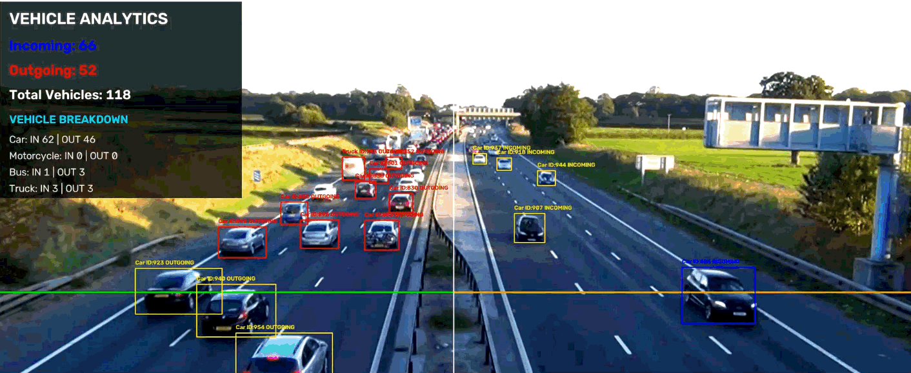
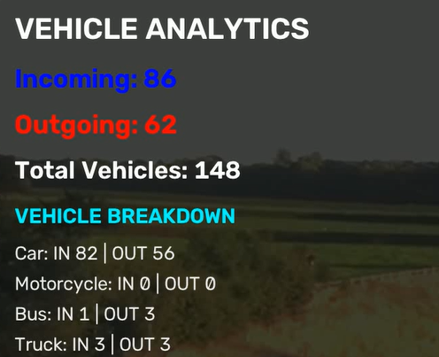
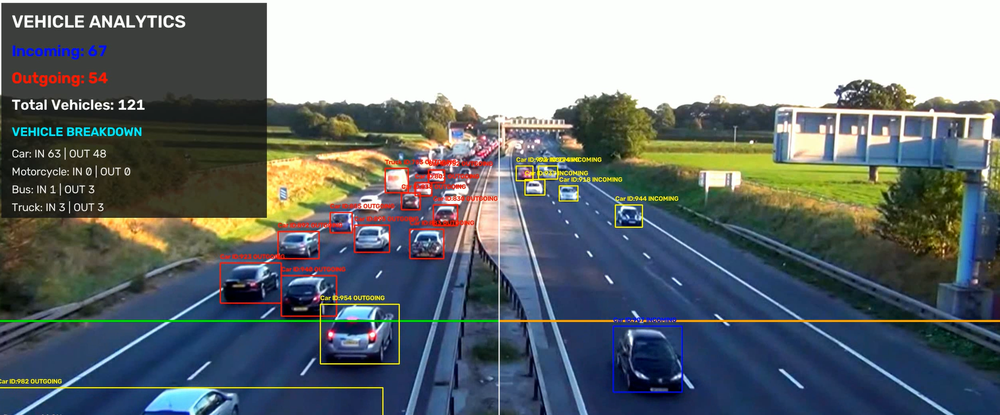

# YOLO Vehicle Counter & Speed Estimator | Intelligent Traffic Analytics



A computer vision project for vehicle detection, multi-object tracking, directional traffic counting, and **real-time vehicle speed estimation** using **YOLO11, ByteTrack, and OpenCV**.

The system processes highway footage, tracks vehicles across video frames, distinguishes incoming and outgoing traffic, calculates real-time vehicle speeds, and generates comprehensive vehicle statistics and CSV reports.

---

## Project Demo

### Watch the Vehicle Counter in Action

**Full demonstration:** [Watch the complete demo video](https://youtu.be/CGzlXJsYTjQ)

The demo showcases vehicle detection, tracking IDs, directional counting, real-time speed calculation, color-coded bounding boxes, and the live analytics dashboard.

---

## Overview

Traffic monitoring is an important application of computer vision. Manually counting vehicles and checking speeds in highway footage can be time-consuming and inconsistent.

This project automates the process by detecting and tracking vehicles throughout a video, calculating their velocities, and counting them when they cross a designated counting line.

The system distinguishes traffic directions, displays live vehicle statistics, and exports structured reports for further analysis.

## Key Features

- **Vehicle Detection:** Detects cars, motorcycles, buses, and trucks using YOLO11.
- **Multi-Object Tracking:** Uses ByteTrack through Ultralytics to maintain vehicle tracking IDs across frames.
- **Real-Time Speed Estimation:** Calculates vehicle speeds dynamically in km/h based on pixel displacement, frame rate, and calibration scaling.
- **Directional Counting:** Counts incoming and outgoing vehicles based on their movement across a horizontal counting line.
- **Color-Coded Tracking:** Uses blue for incoming vehicles, red for outgoing vehicles, and yellow for vehicles that have not yet been counted or whose direction remains unassigned.
- **Live Analytics Dashboard:** Displays incoming counts, outgoing counts, total vehicles, and vehicle-type breakdowns.
- **Video Processing:** Processes input footage and saves an annotated output video.
- **CSV Reporting:** Exports a summary report and individual vehicle-counting and event logs.
- **Progress Monitoring:** Displays processing progress during video analysis.
- **Configurable Detection:** Allows adjustment of confidence threshold, image size, counting-line position, road-divider position, and speed calibration factors.

## Technologies Used

| Technology | Purpose |
|---|---|
| Python | Application development |
| YOLO11 | Vehicle detection |
| ByteTrack | Multi-object tracking |
| Ultralytics | YOLO inference and tracking integration |
| OpenCV | Video processing, bounding boxes, dashboard, and preview |
| NumPy | Numerical operations and distance calculations |
| CSV | Exporting vehicle statistics, speeds, and events |

## Vehicle Classes

The current implementation detects four vehicle categories.

| Vehicle | YOLO Class ID |
|---|---:|
| Car | 2 |
| Motorcycle | 3 |
| Bus | 5 |
| Truck | 7 |

The model processes video frames and associates detections with tracking IDs to help follow vehicles and estimate their speeds as they move through the scene.

## Directional Counting & Speed Calculation

The project uses a horizontal counting line and the movement of tracked vehicles to determine traffic direction and velocity.

- **Incoming:** A vehicle crosses the counting line downward.
- **Outgoing:** A vehicle crosses the counting line upward.
- **Speed Estimation:** Measures pixel distance traveled between frames over elapsed time, converting measurements into km/h.

The road divider, counting-line positions, and meter-per-pixel calibration ratio can be adjusted to suit the camera angle and road layout.

### Bounding-Box Colors

| Color | Meaning |
|---|---|
| Blue | Incoming vehicle |
| Red | Outgoing vehicle |
| Yellow | Detected vehicle not yet counted or direction not yet assigned |

A vehicle is counted when its tracked position crosses the counting line in the appropriate direction.

## Analytics Dashboard

The dashboard displays:

- Incoming vehicle count
- Outgoing vehicle count
- Total counted vehicles
- Incoming and outgoing counts by vehicle category
- Video processing progress

### Dashboard Preview



### Vehicle Detection Preview



## Project Structure

```text
YOLO-Vehicle-Counter/
│
├── src/
│   └── main.py
│
├── videos/
│   └── input.mp4
│
├── output/
│   ├── counted_video.mp4
│   ├── vehicle_report.csv
│   └── vehicle_events.csv
│
├── assets/
│   ├── vehicle-counter-demo.mp4
│   ├── vehicle-counter-demo.gif
│   ├── vehicle-detection.png
│   └── analytics-dashboard.png
│
├── requirements.txt
├── README.md
├── .gitignore
└── LICENSE
```

Generated output files and large input videos may be excluded from version control. The actual folder contents depend on your local configuration.

## Installation

### 1. Clone the Repository

```bash
git clone https://github.com/MobeenFatimaa/YOLO-Vehicle-Counter
cd YOLO-Vehicle-Counter
```

### 2. Create a Virtual Environment

**Windows:**

```powershell
python -m venv venv
```

Activate it:

```powershell
.\venv\Scripts\Activate.ps1
```

If PowerShell blocks activation, you can run the following alternative in Command Prompt after navigating to the project folder:

```bat
venv\Scripts\activate.bat
```

### 3. Install Dependencies

```bash
python -m pip install --upgrade pip
python -m pip install -r requirements.txt
```

The project requires a compatible Python environment and the dependencies listed in `requirements.txt`.

### 4. Prepare an Input Video

Place your video inside the `videos/` directory.

The default input path in the current implementation is:

```text
videos/input.mp4
```

If you use a different filename, update `VIDEO_PATH` in `src/main.py`.

### 5. Run the Application

From the project root, execute:

```bash
python src/main.py
```

The application loads the YOLO model, processes the video with tracking and speed calculations, displays the annotated preview, and saves the generated reports.

Press **Q** in the preview window to stop processing.

## Configuration

The following settings can be adjusted in `src/main.py`.

| Setting | Purpose |
|---|---|
| `VIDEO_PATH` | Input video location |
| `OUTPUT_PATH` | Annotated video output location |
| `CONFIDENCE` | Minimum detection confidence |
| `IMAGE_SIZE` | YOLO inference image size |
| `LINE_Y` | Vertical position of the horizontal counting line |
| `ROAD_SPLIT_X` | Horizontal position of the vertical road divider |
| `PREVIEW_WIDTH` | Maximum preview width |
| `PREVIEW_HEIGHT` | Maximum preview height |
| `MODEL_NAME` | YOLO model weights (`yolo11n.pt`) |
| `METERS_PER_PIXEL` | Pixel-to-meter calibration factor for speeds |

Higher inference image sizes can help detect smaller or distant vehicles, but they may increase processing time and memory use.

The counting-line, road-divider positions, and speed calibration factors should be calibrated for the camera perspective and traffic directions in your footage.

## Output Files

After processing, the application generates three main output files.

### 1. Annotated Video

```text
output/counted_video.mp4
```

Contains the processed video with vehicle bounding boxes, tracking labels, live speeds, counting lines, and analytics.

### 2. Vehicle Summary Report

```text
output/vehicle_report.csv
```

Contains incoming, outgoing, and total counts for each supported vehicle category.

### 3. Vehicle Events Report

```text
output/vehicle_events.csv
```

Records individual counting events, including available tracking IDs, vehicle categories, directions, frame numbers, video timestamps, and event timestamps.

These reports can be opened in spreadsheet applications or analyzed using Python and Pandas.

## Performance and Limitations

Detection, counting, and speed estimation performance depends on video quality, lighting, camera perspective, vehicle size, occlusion, and tracking continuity.

Potential limitations include:

- Small or distant vehicles may be difficult to detect.
- Vehicles that remain occluded may lose their tracking IDs.
- A tracking-ID change can affect counting accuracy and speed consistency.
- Vehicles first detected after crossing the counting line may not be counted.
- Counting-line, road-divider positions, and speed calibration ratios require tuning for different camera angles.
- Processing speed depends on the hardware, model, and inference settings.

The current implementation is configured for the highway footage used during development. Other videos may require different settings.

## Future Improvements

Potential future enhancements include:

- Lane-specific traffic statistics and speed analytics
- Advanced homography / perspective transformation for precise speed metering
- Vehicle trajectory visualization graphs
- Congestion and traffic-density analysis
- Detection of additional vehicle categories
- Improved ID-switch handling and duplicate-count prevention
- Exportable traffic analytics charts
- A web-based monitoring dashboard (e.g., Streamlit / Flask)
- GPU acceleration where supported

## Author

**Mobeen Fatima**

- GitHub: [@MobeenFatimaa](https://github.com/MobeenFatimaa)
- LinkedIn: [Mobeen Fatima](https://www.linkedin.com/in/mobeen-fatima-599a35347/)
- Portfolio: [mobeenfatima.netlify.app](https://mobeenfatima.netlify.app/)

## License

See the `LICENSE` file for the terms under which this project is distributed.

If no license has been added yet, choose and add an appropriate license before presenting the project as open source.

---

**Built with Python, YOLO11, ByteTrack, and OpenCV.**
